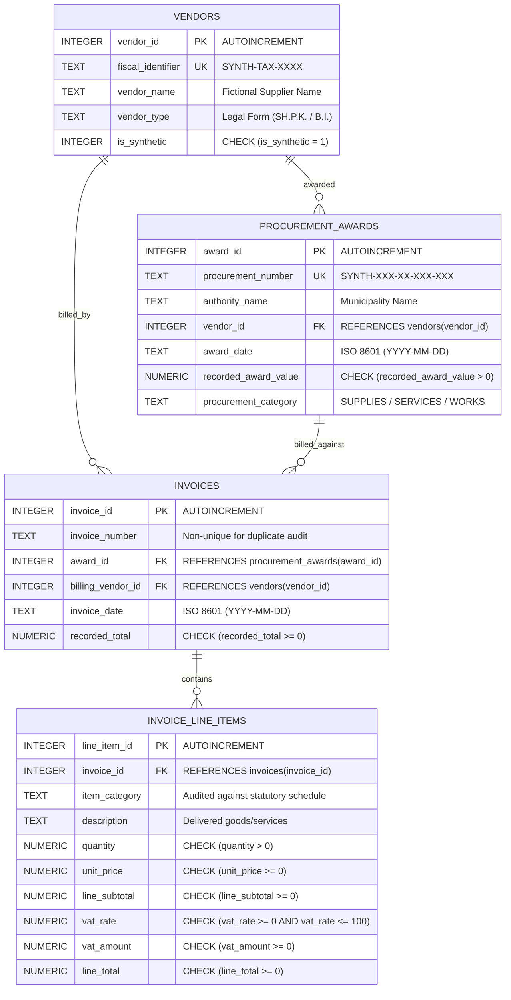

# Entity-Relationship (ER) Diagram

This diagram documents the physical relational model implemented in `sql/schema.sql`.

## Relational Cardinalities & Keys
- **vendors to procurement_awards (1:N)**: A vendor can be awarded multiple public contracts; an award belongs to exactly one winning vendor.
- **procurement_awards to invoices (1:N)**: An award can be billed progressively across multiple invoices; an invoice references exactly one procurement award.
- **vendors to invoices (1:N)**: An invoice header identifies one billing vendor entity (`billing_vendor_id`), which is audited against `procurement_awards.vendor_id` to flag unauthorized third-party billing.
- **invoices to invoice_line_items (1:N)**: An invoice contains one or more itemized lines; a line item belongs to exactly one parent invoice.